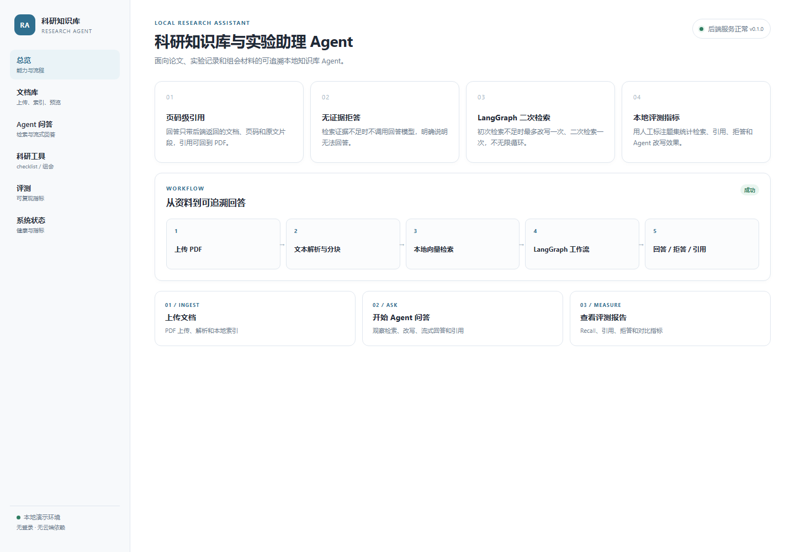

# 科研知识库与实验助理 Agent

一个面向论文与实验记录的本地知识库 Agent 全栈项目。后端采用 FastAPI、
Pydantic Settings、本地文件存储、FAISS 和本地 LLM；前端采用 React、Vite 和
TypeScript，按可扩展的分层结构搭建。

当前已完成：

- **第一阶段**：项目骨架、配置、日志、健康检查、测试和 Docker 配置。
- **第二阶段**：PDF 上传、类型与大小校验、本地保存、PyMuPDF 逐页解析、
  页码保留、JSON 元数据管理、文档列表/详情/删除 API。
- **第三阶段**：页码级分块、本地 Embedding 抽象、FAISS 向量索引、
  索引持久化、检索接口、引用回溯与删除同步。
- **第四阶段**：证据过滤、本地 OpenAI-compatible LLM 单轮问答、
  服务端页码级引用、无证据拒答和模型不可用 503。
- **第五阶段**：LangGraph StateGraph、初次检索、证据判断、
  最多一次问题改写和二次检索、最终回答或明确拒答。
- **第六阶段**：白名单科研工具调用、真实 ToolGraph、基于证据的实验
  checklist、组会总结与安全引用。
- **第七阶段**：FastAPI SSE 流式 Agent、请求 ID、安全日志、
  进程内指标和本地 metrics 接口。
- **第八阶段**：人工标注 JSONL 评测集、检索/引用/拒答/Agent 指标、
  QA 与 Agent 对比和可复现 JSON/Markdown 报告。
- **第九阶段**：React + Vite + TypeScript 本地演示界面、SSE 流式问答、
  PDF 页码引用预览、科研工具、评测报告和系统状态页面。

当前不调用任何在线 API，不使用数据库或云端向量库。向量化和 LLM 均只使用
本机服务或本地模型目录；代码不会自动下载模型，LLM 也不会在启动时被探测。

## 当前阶段实现范围

### 第一阶段（保留）

- [x] `src` 布局的 Python 项目骨架与全部包 `__init__.py`
- [x] FastAPI 应用工厂、生命周期日志与全局异常日志
- [x] `GET /api/v1/health` 健康检查（Pydantic 响应模型）
- [x] `GET /` 项目信息
- [x] 基于 `pydantic-settings` 的环境变量配置，无 `.env` 也能启动
- [x] Python 标准库日志，级别由 `LOG_LEVEL` 控制
- [x] pytest + httpx ASGITransport 异步测试
- [x] Dockerfile、docker-compose.yml 和 Windows 使用说明

### 第二阶段（文档接入基础）

- [x] 检查文件名、扩展名、Content-Type 和文件大小
- [x] 使用 UUID 保存 PDF，禁止将用户文件名直接用作路径
- [x] 使用 PyMuPDF 打开 PDF，按页提取文本
- [x] 页码从 1 开始，空白页保留，字符数逐页记录
- [x] 使用本地 JSON 保存文档元数据和逐页文本
- [x] 元数据原子写入，UTF-8 编码，`ensure_ascii=False`
- [x] 查询文档列表（分页）与文档详情
- [x] 删除文档时同时删除 PDF 和元数据，并限制在配置目录内
- [x] 损坏/伪造 PDF 返回明确 400 错误且不保留成功元数据
- [x] 所有测试使用临时目录，不污染真实 `data` 目录

### 第三阶段（文本分块与本地向量检索）

- [x] 按单页分块，空白页不生成 chunk
- [x] chunk 保留文档 ID、文件名、页码、页内序号和字符范围
- [x] 自然边界优先 + 字符硬切；`CHUNK_OVERLAP < CHUNK_SIZE`
- [x] 可替换 Embedding 接口；真实实现懒加载本地 sentence-transformers
- [x] 强制 `local_files_only=True` 和离线环境变量，不联网下载模型
- [x] FAISS `IndexFlatIP` 本地索引，保存 `index.faiss` 与 `manifest.json`
- [x] 每篇文档保存 `chunks/{document_id}.json`
- [x] 单文档索引、重建索引、自然语言检索 API
- [x] 检索结果返回文档名、文档 ID、页码、chunk 序号、原文和分数
- [x] 删除文档时同步删除 chunk、FAISS 向量和 manifest 记录
- [x] 模型缺失时索引/检索返回 503，其余文档接口正常工作
- [x] 使用 FakeEmbedding 执行真实 FAISS 分块、持久化、重建和检索测试

### 第四阶段（受控问答与引用）

- [x] 复用第三阶段 FAISS 检索，不绕过向量检索直接读全文
- [x] 按 `MIN_RETRIEVAL_SCORE` 过滤证据，按 `MIN_EVIDENCE_COUNT` 判断是否回答
- [x] 证据不足直接返回 `refused`，完全不调用 LLM
- [x] 证据足够才调用本地 OpenAI-compatible `/chat/completions`
- [x] System Prompt 只允许依据证据回答，禁止外部知识和虚构引用
- [x] 服务端从实际送入 LLM 的 evidence 生成引用，不解析模型输出引用
- [x] 引用包含文档名、文档 ID、页码、chunk 序号、原文前缀和分数
- [x] LLM 输出固定拒答句时统一转为 `refused` 且清空 citations
- [x] 模型缺失/LLM 服务不可用时优雅返回 503
- [x] 使用 FakeLLMService 测试；检索、筛选、拒答、引用流程真实执行
- [x] 不记录完整问题、证据正文或模型回答到 INFO 日志

### 第五阶段（LangGraph 改写工作流）

- [x] 使用真实 `langgraph.graph.StateGraph`、节点和条件边
- [x] `POST /api/v1/agent/ask` 单轮 Agent 接口，旧 `/qa/ask` 保持不变
- [x] 初次检索 → 证据判断 → 回答 / 改写 / 拒答
- [x] 仅在初次证据不足且允许改写时执行一次问题改写
- [x] 二次检索使用相同 `document_ids` 和 `top_k`，不扩大范围
- [x] 最多一次改写、最多一次二次检索，图带递归上限
- [x] 二次检索仍不足时明确拒答，不进行第三次检索
- [x] 改写 LLM 失败或输出非法时正常拒答，HTTP 保持 200
- [x] 回答复用第四阶段证据过滤、LLM 和引用生成逻辑
- [x] 返回安全 `workflow` 摘要，不暴露 Prompt、思维链或模型原始响应
- [x] 使用 FakeEmbedding/FakeLLM + 真实 FAISS + 真实 LangGraph 编排测试

### 第六阶段（科研工具调用）

- [x] 白名单只允许三个工具，工具名由 API 显式指定
- [x] 每次请求最多执行一个工具，禁止工具调用自身或其他工具
- [x] 真实 `ToolGraph`：validate → execute once → format → END
- [x] `search_knowledge_base` 复用 FAISS 检索，不调用 LLM
- [x] `generate_experiment_checklist` 只基于检索证据生成结构化 checklist
- [x] checklist 无足够证据时拒答，不调用 LLM
- [x] checklist 服务端校验 JSON、分类、优先级、ID 和 evidence_ids
- [x] checklist 引用来自实际检索证据，不信任模型生成的引用
- [x] `summarize_meeting_notes` 只使用用户输入文本，不检索知识库
- [x] 组会文本按自然段生成稳定 segment ID 和字符范围
- [x] 组会总结校验 owner/deadline 为 null 或字符串，不伪造来源
- [x] 组会超长返回 422，不静默截断
- [x] 统一安全响应和 workflow 摘要，不暴露 Prompt/CoT/原始响应
- [x] 使用 FakeEmbedding/FakeLLM + 真实 FAISS + 真实 ToolGraph 测试

### 第七阶段（SSE 与可观测性）

- [x] `POST /api/v1/agent/ask/stream`，真实 FastAPI `StreamingResponse`
- [x] SSE 事件白名单：workflow / token / citations / final / error
- [x] 复用第五阶段 Agent 图和第四阶段回答/引用逻辑
- [x] 初次有证据时流式 token、citations、final
- [x] 无证据时只发 workflow 和 final(refused)，不调用回答 LLM
- [x] 有证据但回答流式 LLM 不可用：error(llm_unavailable)，不伪造 final
- [x] 改写失败仍走正常 final(refused)，不误报 LLM 流错误
- [x] Request ID Middleware，JSON 与 SSE 响应均带 `X-Request-ID`
- [x] 安全结构化日志和轮转文件日志开关
- [x] 进程内 MetricsService 和 `/api/v1/observability/metrics`
- [x] 不记录问题正文、证据正文、Prompt、token、密钥或绝对路径
- [x] 使用 FakeStreamingLLM + 真实 LangGraph/SSE/Metrics 测试

### 第八阶段（可复现评测）

- [x] 人工标注 UTF-8 JSONL 数据集，严格 Schema 和唯一 id
- [x] 数据集 SHA-256、配置快照、run_id 和 UTC 时间
- [x] 安全数据集文件名校验，禁止路径穿越
- [x] `retrieval` / `qa` / `agent` / `compare` 四种模式
- [x] Recall@K、MRR@K、Citation Precision/Recall
- [x] Refusal Accuracy、Hallucinated Answer Rate、False Refusal Rate
- [x] Keyword Hit Rate 明确定义为弱代理指标
- [x] Agent Rewrite Rate、Retry Success Rate
- [x] QA 与 Agent 使用相同 top_k、document_ids 和阈值
- [x] JSON 与 Markdown 报告原子写入，失败案例可定位
- [x] 单 case 内部错误继续运行；错误率超阈值整体失败
- [x] `/evaluations/run`、列表、单报告 API 和 CLI
- [x] 不使用 LLM-as-a-Judge，不自动生成标签

### 第九阶段（前端与演示体验）

- [x] React 19 + Vite 7 + TypeScript 严格模式
- [x] 原生 CSS、原生 fetch、原生 hooks，无大型 UI 框架
- [x] 六个中文页面：总览、文档库、Agent 问答、科研工具、评测、系统状态
- [x] PDF 上传、文档列表、索引、删除、详情和逐页统计
- [x] 受控 PDF 预览接口 `GET /documents/{document_id}/file`
- [x] 引用点击打开 PDF 抽屉并显示“引用页码：第 N 页”
- [x] 基础 QA 与 LangGraph Agent 模式切换
- [x] fetch + ReadableStream 解析 POST SSE，支持分片、连续事件和取消
- [x] 流式 token、workflow 步骤、拒答、request_id、耗时和引用卡片
- [x] 实验 checklist 和组会总结工具页面
- [x] 评测运行、QA/Agent 对比表、历史报告
- [x] 健康状态、进程内 metrics、能力与限制
- [x] Vite proxy、nginx 多阶段 Docker、SSE 代理配置
- [x] Vitest 覆盖 SSE、API Client、格式化和 Agent 事件
- [x] 实际截图 `docs/screenshots/dashboard.png`

**尚未实现**：OCR、LangChain 业务抽象、多轮对话、WebSocket、多 Agent、
外部网络工具、生产级监控和鉴权、自动执行实验或外部写入操作。
扫描型 PDF 可以上传，但没有文字层时提取结果为空，当前不会自动 OCR。

## 第三至第九阶段数据流

```text
上传 PDF
  → PyMuPDF 按页提取文本
  → POST /documents/{id}/index
  → 单页内分块 → 本地 Embedding → FAISS IndexFlatIP
  → POST /retrieval/search
  → POST /qa/ask（单次检索问答）
  → 证据足够 → 本地 LLM → 服务端 citations
  → 证据不足 → refused

Agent 工作流（POST /agent/ask）：
用户问题
  → 初次检索
  → 证据判断
  ├─ 证据充分 → 回答并返回引用
  └─ 证据不足 → 问题改写 → 二次检索
                       ├─ 证据充分 → 回答并返回引用
                       └─ 仍不足 → 明确拒答
```

上传成功后不会自动索引；用户必须显式调用索引接口。索引、检索和问答均不调用
在线 API，也不会自动下载模型。没有证据的问答不会调用 LLM。

Agent 最多进行一次问题改写和一次二次检索，图不会回到改写节点，也不允许
第三次检索。设置递归上限是为了防止编排错误导致无限循环。

ToolGraph（POST /tools/run）：

```text
API 请求
  → validate_tool_request（白名单 + 参数 Schema）
  → execute_selected_tool（只执行一个工具）
  → format_tool_response（统一安全响应）
  → END
```

工具名必须由 API 显式传入，LLM 不参与选择工具。工具不会自动调用自身、
其他工具、shell、URL 或外部写入操作。checklist 必须基于知识库证据；
组会总结只基于用户提交的组会文本。

SSE 流式 Agent（POST /agent/ask/stream）：

```text
客户端请求
  → workflow(request_received)
  → 检索 / 证据判断
  ├─ 证据足够 → workflow(answer) → token... → citations → final(answered)
  └─ 证据不足 → 改写 → 二次检索
                    ├─ 证据足够 → token... → citations → final(answered)
                    └─ 仍不足 → final(refused)
  → workflow(completed)
```

流式回答只发送模型增量文本；最终引用由服务端根据实际证据生成。
错误只发送安全 error 事件，不返回 Traceback、Prompt、完整 token 或本地路径。

评测流程（POST /evaluations/run）：

```text
人工标注 JSONL
  → Schema/唯一 id/路径安全校验
  → 数据集 SHA-256
  → retrieval / qa / agent / compare
  → Recall、MRR、Citation、Refusal、Keyword、Rewrite 指标
  → JSON + Markdown 安全报告
```

`sample_eval.jsonl` 只是合成示例；没有上传/索引 `sample_experiment.pdf` 时，
answerable 指标会偏低，这是正常结果，不代表真实模型性能。



前端演示流程：

```text
浏览器（React）
  → Vite proxy / nginx
  → FastAPI
  → 上传 PDF / 建立索引
  → 基础 QA 或 Agent SSE
  → 引用点击 → GET /documents/{id}/file#page=N
  → checklist / 组会总结
  → 评测报告与 metrics
```

前端只调用 FastAPI，不直接访问 Ollama、FAISS、模型目录或本地文件系统。
PDF 预览接口只接受已注册的 document UUID，不接受任意文件路径。

## 项目目录结构

```text
research-agent/
├── src/
│   └── research_agent/
│       ├── __init__.py
│       ├── main.py                       # FastAPI 应用、服务装配、生命周期
│       ├── core/
│       │   ├── __init__.py
│       │   ├── config.py                 # Settings 与配置校验
│       │   ├── exceptions.py             # 模型/工具/改写内部异常
│       │   ├── logging.py                # 结构化日志与可选轮转文件
│       │   └── request_context.py        # Request ID 上下文
│       ├── agents/
│       │   ├── __init__.py
│       │   ├── state.py                  # 显式 Agent Graph State
│       │   ├── nodes.py                  # 检索/判断/改写/回答/拒答节点
│       │   ├── research_graph.py         # Agent StateGraph
│       │   ├── tool_state.py             # 工具图 State
│       │   └── tool_graph.py             # 受控 ToolGraph
│       ├── tools/
│       │   ├── __init__.py
│       │   ├── base.py                   # ToolOutcome
│       │   ├── registry.py               # 白名单和参数 Schema
│       │   ├── knowledge_base_tool.py    # 检索工具
│       │   ├── checklist_tool.py         # checklist 工具
│       │   └── meeting_summary_tool.py   # 组会总结工具
│       ├── api/
│       │   ├── __init__.py
│       │   └── routes/
│       │       ├── __init__.py
│       │       ├── health.py             # 健康检查
│       │       ├── documents.py          # 上传/列表/详情/删除/索引
│       │       ├── retrieval.py          # 自然语言检索
│       │       ├── qa.py                 # 单轮问答
│       │       ├── agent.py              # LangGraph Agent 接口
│       │       ├── agent_stream.py       # SSE 流式 Agent
│       │       ├── observability.py      # 本地 metrics 接口
│       │       ├── tools.py              # 统一工具接口
│       │       └── evaluation.py         # 评测运行/列表/报告接口
│       ├── schemas/
│       │   ├── __init__.py
│       │   ├── common.py                 # 通用响应
│       │   ├── documents.py              # 文档与 index_status
│       │   ├── retrieval.py              # chunk、索引和检索模型
│       │   ├── qa.py                     # 问答、证据和引用模型
│       │   ├── agent.py                  # Agent 请求、流程摘要和响应
│       │   └── tools.py                  # 工具输入、输出和统一响应
│       ├── services/
│       │   ├── __init__.py
│       │   ├── README.md
│       │   ├── document_service.py       # 文档生命周期协调
│       │   ├── metadata_service.py       # 元数据领域服务
│       │   ├── pdf_service.py            # PyMuPDF 逐页解析
│       │   ├── chunking_service.py       # 页码级纯函数分块
│       │   ├── embedding_service.py      # 本地 Embedding 抽象与实现
│       │   ├── indexing_service.py       # 索引重建与删除同步
│       │   ├── retrieval_service.py      # 检索结果组装
│       │   ├── llm_service.py            # 本地 OpenAI-compatible LLM
│       │   ├── citation_service.py       # 服务端引用生成
│       │   ├── qa_service.py             # 证据判断、拒答与问答编排
│       │   ├── query_rewrite_service.py  # LLM 问题改写与输出校验
│       │   ├── agent_service.py          # LangGraph 入口和安全摘要
│       │   ├── checklist_service.py      # 证据驱动 checklist 与引用
│       │   ├── meeting_summary_service.py# 组会分段、JSON 校验和引用
│       │   ├── tool_service.py           # ToolGraph 入口和安全摘要
│       │   ├── agent_stream_service.py   # SSE 事件和客户端断开处理
│       │   └── metrics_service.py        # 进程内指标与计量包装器
│       ├── evaluation/
│       │   ├── __init__.py
│       │   ├── schemas.py                # 数据集/样例/报告模型
│       │   ├── dataset_loader.py         # JSONL 校验、哈希、安全路径
│       │   ├── metrics.py                # 纯指标计算
│       │   ├── evaluator.py              # 四模式评测编排
│       │   └── report_service.py         # JSON/Markdown 原子报告
│       └── storage/
│           ├── __init__.py
│           ├── README.md
│           ├── file_storage.py           # PDF 流式保存与安全删除
│           ├── metadata_store.py         # 元数据 JSON 原子读写
│           ├── chunk_store.py            # 每文档 chunk JSON
│           └── vector_store.py           # FAISS + manifest 持久化
├── tests/
│   ├── __init__.py
│   ├── conftest.py                       # 临时目录与应用测试客户端
│   ├── test_health.py                    # 第一阶段测试
│   ├── test_documents.py                 # 第二/九阶段测试（含 PDF 预览）
│   ├── test_retrieval.py                 # 第三阶段分块/索引/检索测试
│   ├── test_qa.py                        # 第四阶段问答/引用/拒答测试
│   ├── test_agent.py                     # 第五阶段 LangGraph 工作流测试
│   ├── test_tools.py                     # 第六阶段工具与 ToolGraph 测试
│   ├── test_streaming.py                 # 第七阶段 SSE 测试
│   ├── test_observability.py             # 第七阶段 Request ID/日志/metrics
│   └── test_evaluation.py                # 第八阶段评测/指标/报告
├── eval/
│   ├── __init__.py
│   ├── datasets/
│   │   ├── sample_eval.jsonl             # 合成示例，不是科研基准
│   │   ├── sample_experiment.pdf         # 合成示例 PDF
│   │   └── README.md
│   ├── reports/README.md
│   └── run_evaluation.py                 # 与 API 共用 EvaluationService
├── web/                                  # React + Vite + TypeScript 前端
│   ├── src/
│   │   ├── api/                          # client、documents、agent、tools、eval
│   │   ├── components/                   # 引用卡片、PDF 抽屉、状态标签
│   │   ├── lib/                          # SSE parser、格式化
│   │   ├── pages/                        # 六个页面
│   │   ├── App.tsx
│   │   ├── main.tsx
│   │   └── styles.css
│   ├── public/
│   ├── package.json
│   ├── package-lock.json
│   ├── vite.config.ts
│   ├── tsconfig.json
│   ├── nginx.conf
│   ├── Dockerfile
│   └── README.md
├── docs/
│   └── screenshots/
│       ├── README.md
│       └── dashboard.png                 # 实际总览页截图
├── scripts/
│   └── download_embedding_model.py       # 有网环境模型下载（规避 hf_xet 坑）
├── data/                                 # 启动时自动创建，已被 .gitignore 忽略
│   ├── documents/                        # UUID.pdf
│   ├── metadata/                         # UUID.json
│   ├── chunks/                           # UUID.json（页码级 chunk）
│   ├── vector_store/                     # index.faiss + manifest.json
│   ├── logs/                             # 可选轮转日志，默认关闭
│   └── evaluations/                      # eval-*.json / eval-*.md
├── models/                               # 本地 Embedding 模型，不提交
│   └── bge-small-zh-v1.5/
├── .dockerignore
├── .env.example
├── .gitignore
├── requirements.txt
├── Dockerfile
├── docker-compose.yml
├── README.md
└── pyproject.toml
```

## 环境要求

- Python 3.11 或更高版本（已在 Python 3.12 上验证）
- Windows 10/11
- Windows PowerShell 5.1 或 PowerShell 7+（推荐）
- pip
- Node.js 20.19+ 与 npm（前端已用 Node 24.20 / npm 11.19 验证）
- Docker Desktop（仅在需要容器运行时安装）

项目运行时不访问外网，不依赖数据库或外部 API。

## Windows 本地安装

### 1. 进入项目目录

```powershell
cd E:\Documents\deepseek-harness\default-workspace\research-agent
```

### 2. 创建并激活虚拟环境

```powershell
python -m venv .venv
.\.venv\Scripts\Activate.ps1
```

如果 PowerShell 提示禁止运行脚本，可仅对当前终端临时放开：

```powershell
Set-ExecutionPolicy -Scope Process -ExecutionPolicy Bypass
.\.venv\Scripts\Activate.ps1
```

### 3. 安装依赖

```powershell
python -m pip install --upgrade pip
python -m pip install -r requirements.txt
```

如果 pip 在本机解析索引时长时间无输出，可禁用缓存重试：

```powershell
python -m pip install --no-cache-dir -r requirements.txt
```

`sentence-transformers` 会安装 PyTorch。若默认 PyPI 下载 torch 很慢，可以先装 CPU 版本：

```powershell
python -m pip install torch --index-url https://download.pytorch.org/whl/cpu
python -m pip install -r requirements.txt
```

主要依赖：

- `PyMuPDF`：PDF 打开和逐页文本提取
- `python-multipart`：FastAPI `multipart/form-data` 上传解析
- `numpy`：Embedding 向量与数值处理
- `faiss-cpu`：本地向量索引（`IndexFlatIP`）
- `sentence-transformers`：从本地目录加载 Embedding 模型
- `langgraph`：第五阶段 StateGraph 工作流（`langchain-core` 仅作为其依赖带入，业务代码不依赖 LangChain 抽象）

### 4. 本地 Embedding 模型准备

代码**不会自动下载模型**。需要在有网环境预先下载模型，再把整个目录复制到离线环境：

```powershell
pip install -U huggingface_hub
python scripts/download_embedding_model.py
```

脚本等价于手工执行 `snapshot_download('BAAI/bge-small-zh-v1.5',
local_dir='models/bge-small-zh-v1.5')`，并额外做了两件事：

- 在导入下载库之前关闭 hf_xet 后端。Windows 上该后端拉取权重会报
  `xet_get ... os error 5 拒绝访问`，换镜像源无效，走普通 HTTP 才能成功。
- 把 HF 缓存目录固定为项目内 `.hf-cache`，不写入用户主目录的系统缓存。

可选参数：`--repo` 换模型仓库，`--endpoint https://hf-mirror.com` 走镜像，
`--local-dir` 换保存目录。默认跳过 `*.bin`/`*.onnx` 等重复权重格式（同份权重
约 91 MB，`sentence-transformers` 只需要 `model.safetensors`），需要时可加
`--with-other-weights`。

上述下载脚本只应在有网环境执行；本项目运行代码不会调用它。

默认读取：

```text
./models/bge-small-zh-v1.5
```

也可以通过 `EMBEDDING_MODEL_PATH` 指向其他本地目录。模型目录至少应包含
`sentence-transformers` 能识别的配置、权重和 tokenizer 文件。

- 服务启动不会加载模型；只有建立索引或检索时才懒加载。
- 模型目录不存在或加载失败时，索引/检索返回 `503`，上传和文档管理仍然可用。
- 运行库强制 `local_files_only=True`，并设置 Hugging Face 离线环境变量。
- 测试使用确定性 FakeEmbedding，不加载真实模型，也不需要下载模型。

### 5. 本地 LLM 准备

第四阶段使用本地 **OpenAI-compatible HTTP 接口**，不引入 OpenAI SDK。
默认配置兼容 Ollama：

```text
LLM_BASE_URL=http://127.0.0.1:11434/v1
LLM_MODEL=qwen2.5:3b-instruct
LLM_API_KEY=
```

Ollama 仅作为示例。需要在有网环境由用户自行启动服务并准备模型：

```powershell
ollama serve
ollama pull qwen2.5:3b-instruct
```

项目代码**不会自动下载模型**，也不会在启动时主动请求 LLM 服务。
只有用户发起有足够证据的问答时，才请求 `POST {LLM_BASE_URL}/chat/completions`。

- `LLM_BASE_URL` 应指向本机、Docker 内部服务或 `host.docker.internal` 的本地服务。
- `LLM_API_KEY` 为空时不发送 Authorization；非空时发送 Bearer Header。
- 连接失败、超时、非 2xx、响应 JSON 缺 content 时统一返回 503。
- LLM 不可用时，有证据的问答返回 503；无证据问题仍正常 `refused`，不调用 LLM。
- Docker 容器内不能直接使用宿主机的 `127.0.0.1`，Compose 示例使用
  `host.docker.internal`，可按实际本地服务地址覆盖。
- 离线学校环境不得把 `LLM_BASE_URL` 指向在线大模型 API。

### 6. 可选：创建本地配置

不创建 `.env` 也可以启动，因为 `Settings` 提供了完整默认值。需要自定义时：

```powershell
Copy-Item .env.example .env
```

`.env` 已被 `.gitignore` 忽略，禁止提交任何密钥。`LLM_API_KEY` 默认为空，
只有本地服务确实需要鉴权时才设置。

### 7. 启动服务

```powershell
uvicorn src.research_agent.main:app --reload --host 127.0.0.1 --port 8000
```

启动后会自动创建：

```text
data/documents/
data/metadata/
data/chunks/
data/vector_store/
```

访问地址：

- 项目信息：<http://127.0.0.1:8000/>
- 健康检查：<http://127.0.0.1:8000/api/v1/health>
- Swagger 文档：<http://127.0.0.1:8000/docs>
- OpenAPI：<http://127.0.0.1:8000/openapi.json>

> Swagger UI 的 JS/CSS 默认从外部 CDN 加载；在无法访问该 CDN 的网络中，
> `/docs` 可能显示空白，但 API 本身不受影响。可以直接访问接口或 `/openapi.json`。

启动日志示例：

```text
应用启动: 科研知识库与实验助理 Agent v0.1.0 (debug=False, api_prefix=/api/v1)
```

### 8. 启动前端

另开一个 PowerShell 窗口：

```powershell
cd web
npm install
npm run dev
```

打开 <http://127.0.0.1:5173>。开发服务器通过 Vite proxy 把 `/api` 转发到
`http://127.0.0.1:8000`，因此本地开发不需要处理 CORS。

```text
浏览器 :5173
  → /api/* 由 Vite 代理
  → FastAPI :8000
```

前端构建与单元测试：

```powershell
npm run test
npm run build
```

截图见 `docs/screenshots/dashboard.png`。

### 9. 运行测试

```powershell
python -m pytest
```

完整输出：

```powershell
python -m pytest -vv -s
```

测试使用 `httpx.AsyncClient` + `ASGITransport`，通过 AnyIO 的 asyncio 后端运行，
不创建真实测试服务器，也不访问外部服务。测试中的应用配置会把 PDF、元数据、
chunk 和向量索引写入 pytest 临时目录。第三阶段使用 FakeEmbeddingService，
第四阶段额外注入 FakeLLMService；第五阶段使用真实 FAISS、真实 LangGraph
StateGraph，仅推理模型用 Fake 替代。

预期结果（具体以实际执行为准）：

```text
149 passed
```

## 数据目录说明

默认布局：

```text
data/
├── documents/
│   └── {document_id}.pdf
├── metadata/
│   └── {document_id}.json
├── chunks/
│   └── {document_id}.json
└── vector_store/
    ├── index.faiss
    └── manifest.json
```

- PDF 与元数据使用同一个 UUID 关联。
- 用户原始文件名只保存在元数据中，不参与保存路径。
- `chunks/{id}.json` 保存该文档的页码级 chunk 数组。
- `manifest.json` 保存向量位置到 chunk 元数据的映射，FAISS 位置与数组顺序一致。
- `documents`、`metadata`、`chunks`、`vector_store` 目录都可以在 `.env` 中覆盖。
- 应用启动时会自动创建配置的目录。
- `data/` 和 `models/` 已被 `.gitignore` 忽略。

元数据示例：

```json
{
  "id": "a9d1a1da-3c22-4bf0-8ef5-6dc8e7e0a111",
  "original_filename": "paper.pdf",
  "stored_filename": "a9d1a1da-3c22-4bf0-8ef5-6dc8e7e0a111.pdf",
  "file_size": 12345,
  "page_count": 2,
  "created_at": "2026-11-03T10:00:00+00:00",
  "status": "processed",
  "index_status": "not_indexed",
  "pages": [
    {
      "page_number": 1,
      "text": "第一页文本",
      "character_count": 6
    },
    {
      "page_number": 2,
      "text": "",
      "character_count": 0
    }
  ]
}
```

写入元数据时先写同目录临时文件，再替换目标 JSON，降低写入中断留下半个文件的风险。
`status` 包含 `processed` 和 `failed`；上传失败会直接返回错误且不保留成功元数据。
`index_status` 包含 `not_indexed`、`indexed`、`failed`，上传后默认
`not_indexed`，索引成功后更新为 `indexed`。

## 配置说明

配置读取优先级：进程环境变量 > 项目根目录 `.env` > 代码默认值。
所有字段均不要求存在，缺少时使用下列默认值。

| 环境变量 | 默认值 | 说明 |
| --- | --- | --- |
| `APP_NAME` | `科研知识库与实验助理 Agent` | 应用标题与项目名称 |
| `APP_VERSION` | `0.1.0` | 应用版本 |
| `DEBUG` | `false` | FastAPI 调试模式 |
| `API_PREFIX` | `/api/v1` | API 路由统一前缀 |
| `LOG_LEVEL` | `INFO` | `DEBUG` / `INFO` / `WARNING` / `ERROR` / `CRITICAL` |
| `DATA_DIR` | `./data` | 本地数据根目录 |
| `MAX_UPLOAD_SIZE_MB` | `20` | 单个上传文件最大大小（MB） |
| `DOCUMENTS_DIR` | `./data/documents` | PDF 保存目录 |
| `METADATA_DIR` | `./data/metadata` | JSON 元数据保存目录 |
| `CHUNKS_DIR` | `./data/chunks` | 每文档 chunk JSON 目录 |
| `VECTOR_STORE_DIR` | `./data/vector_store` | FAISS 索引与 manifest 目录 |
| `EMBEDDING_MODEL_PATH` | `./models/bge-small-zh-v1.5` | 本地模型目录，不会自动下载 |
| `EMBEDDING_DEVICE` | `cpu` | Embedding 推理设备 |
| `EMBEDDING_NORMALIZE` | `true` | 是否做 L2 归一化 |
| `CHUNK_SIZE` | `500` | 单 chunk 最大字符数 |
| `CHUNK_OVERLAP` | `80` | 相邻 chunk 重叠字符数，必须小于 `CHUNK_SIZE` |
| `RETRIEVAL_TOP_K` | `5` | 默认检索返回数量，最大 20 |
| `MAX_RETRIEVAL_TEXT_LENGTH` | `1000` | 返回原文片段最大长度 |
| `QA_TOP_K` | `5` | 问答默认检索数量，最大 20 |
| `MIN_RETRIEVAL_SCORE` | `0.35` | 进入证据集的最低相似度 |
| `MIN_EVIDENCE_COUNT` | `1` | 调用 LLM 的最少证据数量 |
| `MAX_CONTEXT_CHARS` | `6000` | 送入 LLM 的证据文本总上限 |
| `MAX_CITATION_TEXT_LENGTH` | `500` | 引用原文最大长度 |
| `LLM_BASE_URL` | `http://127.0.0.1:11434/v1` | 本地 OpenAI-compatible 服务 |
| `LLM_MODEL` | `qwen2.5:3b-instruct` | 本地模型名 |
| `LLM_API_KEY` | 空 | 仅本地服务需要时设置 |
| `LLM_TIMEOUT_SECONDS` | `60` | 调用超时 |
| `LLM_TEMPERATURE` | `0.0` | 生成温度 |
| `LLM_MAX_TOKENS` | `512` | 最大输出 token |
| `ENABLE_QUERY_REWRITE` | `true` | 全局是否允许问题改写 |
| `MAX_QUERY_REWRITE_ATTEMPTS` | `1` | 只允许 0 或 1 |
| `REWRITE_MAX_CHARS` | `500` | 改写查询最大字符数 |
| `AGENT_TOP_K` | `5` | Agent 默认检索数量，最大 20 |
| `AGENT_MAX_CONTEXT_CHARS` | `6000` | Agent 证据文本总上限 |
| `AGENT_TRACE_ENABLED` | `true` | 是否返回安全工作流摘要 |
| `MAX_MEETING_CONTEXT_CHARS` | `16000` | 组会有效段落总字符上限 |
| `ENABLE_STREAMING` | `true` | 是否启用 SSE Agent 接口 |
| `STREAM_HEARTBEAT_SECONDS` | `15` | SSE 心跳间隔，0 关闭 |
| `ENABLE_FILE_LOGGING` | `false` | 是否启用本地轮转文件日志 |
| `LOG_DIR` | `./data/logs` | 文件日志目录 |
| `LOG_MAX_BYTES` | `5242880` | 单文件最大字节数 |
| `LOG_BACKUP_COUNT` | `3` | 日志备份数量 |
| `ENABLE_METRICS_ENDPOINT` | `true` | 是否启用本地 metrics 接口 |
| `EVAL_DATASET_DIR` | `./eval/datasets` | JSONL 数据集目录 |
| `EVALUATION_DIR` | `./data/evaluations` | 评测报告目录 |
| `EVALUATION_MAX_CASES` | `100` | 单次最大样例数 |
| `EVALUATION_MAX_ERROR_RATE` | `0.2` | 内部错误比例上限 |
| `EVALUATION_SAVE_DETAILS` | `false` | 是否保存截断问题/回答 |

示例：

```powershell
$env:LOG_LEVEL = "DEBUG"
$env:MAX_UPLOAD_SIZE_MB = "10"
$env:DOCUMENTS_DIR = "./data/documents"
$env:METADATA_DIR = "./data/metadata"
$env:CHUNKS_DIR = "./data/chunks"
$env:VECTOR_STORE_DIR = "./data/vector_store"
$env:EMBEDDING_MODEL_PATH = "./models/bge-small-zh-v1.5"
$env:CHUNK_SIZE = "500"
$env:CHUNK_OVERLAP = "80"
$env:QA_TOP_K = "5"
$env:MIN_RETRIEVAL_SCORE = "0.35"
$env:LLM_BASE_URL = "http://127.0.0.1:11434/v1"
$env:LLM_MODEL = "qwen2.5:3b-instruct"
$env:ENABLE_QUERY_REWRITE = "true"
$env:MAX_QUERY_REWRITE_ATTEMPTS = "1"
$env:AGENT_TOP_K = "5"
$env:MAX_MEETING_CONTEXT_CHARS = "16000"
$env:ENABLE_STREAMING = "true"
$env:STREAM_HEARTBEAT_SECONDS = "15"
$env:ENABLE_FILE_LOGGING = "false"
$env:LOG_DIR = "./data/logs"
$env:ENABLE_METRICS_ENDPOINT = "true"
$env:EVAL_DATASET_DIR = "./eval/datasets"
$env:EVALUATION_DIR = "./data/evaluations"
$env:EVALUATION_MAX_CASES = "100"
$env:EVALUATION_MAX_ERROR_RATE = "0.2"
uvicorn src.research_agent.main:app --reload --port 8000
```

注意：环境变量在启动服务的终端中设置，重启终端后失效；持久配置请使用 `.env`。

## API 示例

所有业务接口统一使用配置中的 `API_PREFIX`，默认为 `/api/v1`。

### 根路径

```powershell
Invoke-RestMethod -Uri http://127.0.0.1:8000/ | ConvertTo-Json
```

响应：

```json
{
  "name": "科研知识库与实验助理 Agent",
  "version": "0.1.0",
  "description": "面向论文与实验记录的知识库与实验助理后端（第九阶段：前端与本地演示体验）。"
}
```

### 健康检查

```powershell
Invoke-RestMethod -Uri http://127.0.0.1:8000/api/v1/health | ConvertTo-Json
```

响应：

```json
{
  "status": "ok",
  "service": "research-agent",
  "version": "0.1.0"
}
```

### 上传 PDF

PowerShell 7+：

```powershell
$form = @{
    file = Get-Item .\example.pdf
}
Invoke-RestMethod `
    -Uri http://127.0.0.1:8000/api/v1/documents `
    -Method Post `
    -Form $form
```

如果使用 Windows PowerShell 5.1（不支持 `-Form`），可以使用：

```powershell
curl.exe -X POST `
    -F "file=@.\example.pdf;type=application/pdf" `
    http://127.0.0.1:8000/api/v1/documents
```

成功返回 `201 Created` 和完整文档详情：

```json
{
  "id": "a9d1a1da-3c22-4bf0-8ef5-6dc8e7e0a111",
  "original_filename": "example.pdf",
  "stored_filename": "a9d1a1da-3c22-4bf0-8ef5-6dc8e7e0a111.pdf",
  "file_size": 12345,
  "page_count": 2,
  "created_at": "2026-11-03T10:00:00+00:00",
  "status": "processed",
  "index_status": "not_indexed",
  "pages": [
    {
      "page_number": 1,
      "text": "...",
      "character_count": 1234
    },
    {
      "page_number": 2,
      "text": "",
      "character_count": 0
    }
  ]
}
```

请求使用 `multipart/form-data`，字段名必须是 `file`。

### 为文档建立或重建索引

先获取文档 ID：

```powershell
$documents = Invoke-RestMethod `
    -Uri "http://127.0.0.1:8000/api/v1/documents?page=1&page_size=20"
$documentId = $documents.items[0].id
```

为文档建立索引：

```powershell
Invoke-RestMethod `
    -Uri "http://127.0.0.1:8000/api/v1/documents/$documentId/index" `
    -Method Post
```

成功响应：

```json
{
  "document_id": "a9d1a1da-3c22-4bf0-8ef5-6dc8e7e0a111",
  "status": "indexed",
  "page_count": 2,
  "chunk_count": 7,
  "embedding_dimension": 512
}
```

- 重复调用会重建该文档索引，不会产生重复 chunk。
- 文档不存在返回 `404`。
- 本地模型缺失或加载失败返回 `503`：

```json
{
  "detail": "本地 Embedding 模型不可用，请检查 EMBEDDING_MODEL_PATH 配置和模型文件。"
}
```

### 检索相关文本块

```powershell
$body = @{
    query = "实验中为什么需要空白对照？"
    top_k = 5
} | ConvertTo-Json

Invoke-RestMethod `
    -Uri "http://127.0.0.1:8000/api/v1/retrieval/search" `
    -Method Post `
    -ContentType "application/json" `
    -Body $body
```

可选地按文档过滤：

```powershell
$body = @{
    query = "实验中为什么需要空白对照？"
    top_k = 5
    document_ids = @($documentId)
} | ConvertTo-Json

Invoke-RestMethod `
    -Uri "http://127.0.0.1:8000/api/v1/retrieval/search" `
    -Method Post `
    -ContentType "application/json" `
    -Body $body
```

响应示例：

```json
{
  "query": "实验中为什么需要空白对照？",
  "results": [
    {
      "chunk_id": "a9d1a1da-3c22-4bf0-8ef5-6dc8e7e0a111:p2:c0",
      "document_id": "a9d1a1da-3c22-4bf0-8ef5-6dc8e7e0a111",
      "original_filename": "experiment.pdf",
      "page_number": 2,
      "chunk_index": 0,
      "text": "原文片段……",
      "char_start": 0,
      "char_end": 300,
      "score": 0.82
    }
  ]
}
```

检索只返回原文片段和引用信息，**不生成回答**。没有索引或没有匹配结果时返回
`200` 和空 `results`。`MAX_RETRIEVAL_TEXT_LENGTH` 只截断返回文本的前缀，
不改变页码、chunk ID 和分数。

### 单轮问答

```powershell
$body = @{
    question = "实验中为什么要设置空白对照？"
    top_k = 5
} | ConvertTo-Json -Depth 4

Invoke-RestMethod `
    -Uri "http://127.0.0.1:8000/api/v1/qa/ask" `
    -Method Post `
    -ContentType "application/json" `
    -Body $body
```

有足够证据时返回：

```json
{
  "status": "answered",
  "answer": "根据资料，设置空白对照可用于……",
  "citations": [
    {
      "citation_id": "citation-1",
      "chunk_id": "uuid:p2:c0",
      "document_id": "uuid",
      "original_filename": "experiment.pdf",
      "page_number": 2,
      "chunk_index": 0,
      "text": "原文片段……",
      "char_start": 0,
      "char_end": 300,
      "score": 0.83
    }
  ],
  "retrieval": {
    "query": "实验中为什么要设置空白对照？",
    "retrieved_count": 3,
    "evidence_count": 2,
    "top_k": 5
  },
  "refusal_reason": null
}
```

没有足够证据时，接口仍返回 200，但不调用 LLM：

```json
{
  "status": "refused",
  "answer": "无法根据已检索到的资料回答该问题。",
  "citations": [],
  "retrieval": {
    "query": "不存在的问题",
    "retrieved_count": 0,
    "evidence_count": 0,
    "top_k": 5
  },
  "refusal_reason": "未检索到足够相关的文档证据。"
}
```

引用完全由服务端根据实际送入 LLM 的证据块生成，不解析模型回答中的引用。
模型如果输出固定拒答句，也会被统一转换为 `refused` 且 citations 为空。

### LangGraph Agent 问答

旧 `qa/ask` 只检索一次；`agent/ask` 在初次证据不足时最多改写一次并二次检索。

```powershell
$body = @{
    question = "实验中为什么要设置空白对照？"
    top_k = 5
    enable_rewrite = $true
} | ConvertTo-Json -Depth 4

Invoke-RestMethod `
    -Uri "http://127.0.0.1:8000/api/v1/agent/ask" `
    -Method Post `
    -ContentType "application/json" `
    -Body $body
```

有足够证据时返回：

```json
{
  "status": "answered",
  "answer": "根据资料，空白对照用于……",
  "citations": [
    {
      "citation_id": "citation-1",
      "chunk_id": "uuid:p2:c0",
      "document_id": "uuid",
      "original_filename": "experiment.pdf",
      "page_number": 2,
      "chunk_index": 0,
      "text": "原文片段……",
      "char_start": 0,
      "char_end": 300,
      "score": 0.83
    }
  ],
  "workflow": {
    "original_question": "实验中为什么要设置空白对照？",
    "final_query": "实验 空白对照 作用",
    "rewrite_attempted": true,
    "rewrite_count": 1,
    "rewrite_changed": true,
    "steps": [
      "retrieve_initial",
      "assess_initial_evidence",
      "rewrite_query",
      "retrieve_retry",
      "assess_retry_evidence",
      "answer"
    ],
    "initial_retrieval_count": 0,
    "final_retrieval_count": 2,
    "evidence_count": 2
  },
  "refusal_reason": null
}
```

二次检索仍不足时返回 HTTP 200：

```json
{
  "status": "refused",
  "answer": "无法根据已检索到的资料回答该问题。",
  "citations": [],
  "workflow": {
    "original_question": "不存在的问题",
    "final_query": "改写后的查询",
    "rewrite_attempted": true,
    "rewrite_count": 1,
    "rewrite_changed": true,
    "steps": [
      "retrieve_initial",
      "assess_initial_evidence",
      "rewrite_query",
      "retrieve_retry",
      "assess_retry_evidence",
      "refuse"
    ],
    "initial_retrieval_count": 0,
    "final_retrieval_count": 0,
    "evidence_count": 0
  },
  "refusal_reason": "经过问题改写和二次检索后，仍未检索到足够相关的文档证据。"
}
```

`enable_rewrite=false` 或全局 `ENABLE_QUERY_REWRITE=false` 时直接拒答，不调用
改写 LLM。`MAX_QUERY_REWRITE_ATTEMPTS` 只能是 0 或 1，请求不能覆盖。
改写服务不可用或输出为空、过长、Markdown/JSON、拒答句时，也直接拒答，
不再二次检索。工作流 `steps` 只是安全节点名，不包含 Prompt 或思维链。

| 接口 | 检索次数 | 问题改写 | 用途 |
| --- | --- | --- | --- |
| `/api/v1/qa/ask` | 1 | 否 | 第四阶段单轮问答 |
| `/api/v1/agent/ask` | 1 或 2 | 最多 1 次 | LangGraph 检索增强工作流 |

### 科研工具

统一接口：

```text
POST /api/v1/tools/run
```

工具名只能是：

```text
search_knowledge_base
generate_experiment_checklist
summarize_meeting_notes
```

每次请求只执行一个工具，不接受任意函数名、shell、URL 或模块名。

检索工具：

```powershell
$body = @{
    tool_name = "search_knowledge_base"
    arguments = @{
        query = "实验中空白对照的作用"
        top_k = 5
    }
} | ConvertTo-Json -Depth 5

Invoke-RestMethod `
    -Uri "http://127.0.0.1:8000/api/v1/tools/run" `
    -Method Post `
    -ContentType "application/json" `
    -Body $body
```

实验 checklist：

```powershell
$body = @{
    tool_name = "generate_experiment_checklist"
    arguments = @{
        experiment_goal = "比较不同温度对酶活性的影响"
        constraints = @("样品数量有限", "需要设置空白对照")
        top_k = 5
    }
} | ConvertTo-Json -Depth 5

Invoke-RestMethod `
    -Uri "http://127.0.0.1:8000/api/v1/tools/run" `
    -Method Post `
    -ContentType "application/json" `
    -Body $body
```

组会总结：

```powershell
$body = @{
    tool_name = "summarize_meeting_notes"
    arguments = @{
        meeting_title = "2026-11-07 组会"
        meeting_text = "实验进度：完成 A 组。`n`n下周计划：补做 B 组。"
        focus = "实验进度与下周安排"
    }
} | ConvertTo-Json -Depth 5

Invoke-RestMethod `
    -Uri "http://127.0.0.1:8000/api/v1/tools/run" `
    -Method Post `
    -ContentType "application/json" `
    -Body $body
```

统一响应：

```json
{
  "status": "success",
  "tool_name": "search_knowledge_base",
  "result": {
    "query": "实验中空白对照的作用",
    "results": []
  },
  "workflow": {
    "steps": [
      "validate_tool_request",
      "execute_selected_tool",
      "format_tool_response"
    ],
    "llm_called": false,
    "retrieval_count": 0,
    "evidence_count": 0
  },
  "refusal_reason": null
}
```

工具边界：

- 检索工具只返回已有 FAISS 检索字段，不调用 LLM。
- checklist 必须先过 `MIN_RETRIEVAL_SCORE` 和 `MIN_EVIDENCE_COUNT`；
  无证据时返回 200 refused，不调用 LLM。
- checklist 的 citations 只来自实际传给模型的证据，伪造 `evidence_ids` 返回 503。
- 组会总结不检索知识库，只使用 `meeting_text`；按自然段生成稳定 segment ID。
- 组会文本为空、超过 `MAX_MEETING_CONTEXT_CHARS` 时返回 422，不调用 LLM。
- 组会总结的 owner/deadline 没有原文明确信息时必须为 null；
  `source_segment_ids` 不存在时返回 503。
- 工具输出不包含 Prompt、模型原始响应、思维链、API Key 或绝对路径。

### SSE 流式 Agent

```powershell
curl.exe -N `
  -X POST "http://127.0.0.1:8000/api/v1/agent/ask/stream" `
  -H "Content-Type: application/json" `
  -d "{\"question\":\"实验中为什么要设置空白对照？\",\"top_k\":5,\"enable_rewrite\":true}"
```

响应：

```text
Content-Type: text/event-stream; charset=utf-8
Cache-Control: no-cache
Connection: keep-alive
X-Accel-Buffering: no
X-Request-ID: <request_id>
```

事件顺序：

```text
workflow(request_received)
→ workflow(retrieve_initial)
→ workflow(assess_initial_evidence)
→ [workflow(rewrite_query) → workflow(retrieve_retry)
   → workflow(assess_retry_evidence)]
→ workflow(answer)
→ token...
→ citations
→ workflow(completed)
→ final
```

无证据时没有 token/citations：

```text
workflow(request_received)
→ workflow(retrieve_initial)
→ workflow(assess_initial_evidence)
→ workflow(completed)
→ final(status=refused)
```

事件格式：

```text
event: workflow
data: {"request_id":"...","step":"retrieve_initial","message":"正在检索知识库"}

event: token
data: {"request_id":"...","content":"根据资料，"}

event: citations
data: {"request_id":"...","citations":[...]}

event: final
data: {"request_id":"...","status":"answered","workflow":{...},"metrics":{...}}
```

错误事件：

```text
event: error
data: {"request_id":"...","code":"llm_unavailable","message":"本地 LLM 服务不可用，请检查本地模型服务状态。"}
```

- `citations` 只发送一次，且只在 `status=answered` 时发送。
- `final` 正常完成时只发送一次；流开始后的错误没有 `final`。
- 嵌入模型不可用时，流式接口会先发送 `error(embedding_unavailable)`；
  不会伪造 token 或 final。
- 回答 LLM 不可用时发送 `error(llm_unavailable)`，不发送 citations。
- 不发送 Prompt、思维链、模型原始响应、密钥或绝对路径。
- `STREAM_HEARTBEAT_SECONDS` 控制 SSE 注释心跳；0 表示关闭。

### Request ID 与 Metrics

每个 HTTP 响应都带：

```text
X-Request-ID: <uuid-or-client-safe-id>
```

客户端传入的 `X-Request-ID` 必须是最多 128 位安全字符，否则服务生成 UUID4。
请求 ID 会进入结构化日志，但不作为认证信息。

读取进程内指标：

```powershell
Invoke-RestMethod `
  -Uri "http://127.0.0.1:8000/api/v1/observability/metrics" `
  -Method Get | ConvertTo-Json -Depth 8
```

主要字段：

- `requests_total`
- `requests_by_path`
- `responses_by_status`
- `agent_stream.requests_total`
- `agent_stream.answered_total`
- `agent_stream.refused_total`
- `agent_stream.errors_total`
- `agent_stream.average_duration_ms`
- `llm.calls_total`
- `llm.stream_calls_total`
- `llm.errors_total`
- `tool_requests_total`
- `embedding_errors_total`
- `total_request_duration_ms`
- `generated_at`

指标只在内存中保存，重启清零；不写数据库、不调用 LLM/Embedding。
该接口默认无认证，仅适合本地开发，生产环境必须加鉴权或移除。

文件日志默认关闭。启用后写入 `LOG_DIR/app.log`，使用轮转，且日志只记录请求 ID、
路径、状态、耗时和安全事件，不记录问题、证据正文、Prompt、token、密钥或绝对路径。

### 评测 API 与 CLI

评测集是 UTF-8 JSONL，每行包含：

```json
{
  "id": "answerable-001",
  "question": "实验中为什么需要设置空白对照？",
  "answerable": true,
  "document_ids": [],
  "expected_sources": [
    {"original_filename": "experiment_notes.pdf", "page_number": 2}
  ],
  "expected_answer_keywords": ["空白对照", "背景", "比较"],
  "notes": "人工标注：第 2 页明确说明空白对照作用。"
}
```

`answerable=false` 时必须没有 `expected_sources`。标签必须由人工编写或确认，
不能使用被评测模型生成的答案作为标签。

API：

```powershell
$body = @{
  dataset_name = "sample_eval.jsonl"
  mode = "compare"
  top_k = 5
} | ConvertTo-Json

Invoke-RestMethod `
  -Uri "http://127.0.0.1:8000/api/v1/evaluations/run" `
  -Method Post `
  -ContentType "application/json" `
  -Body $body | ConvertTo-Json -Depth 10
```

查看最近运行：

```powershell
Invoke-RestMethod "http://127.0.0.1:8000/api/v1/evaluations" |
  ConvertTo-Json -Depth 8
```

查看单次报告：

```powershell
Invoke-RestMethod `
  "http://127.0.0.1:8000/api/v1/evaluations/<run_id>" |
  ConvertTo-Json -Depth 10
```

CLI：

```powershell
python -m eval.run_evaluation `
  --dataset eval/datasets/sample_eval.jsonl `
  --mode compare `
  --top-k 5
```

四种模式：

- `retrieval`：只做检索和 Recall/MRR，不需要 LLM。
- `qa`：单次检索问答，评估引用、拒答和关键词弱指标。
- `agent`：LangGraph 改写/二次检索工作流。
- `compare`：同一数据集上分别运行 QA 和 Agent，阈值与 top_k 相同。

指标定义：

```text
Recall@K = 命中的 answerable 样例数 / answerable 样例总数
MRR@K = answerable 样例 reciprocal_rank 的平均值
Citation Precision = 正确 citations / 返回 citations
Citation Recall = 命中的期望来源数 / 期望来源总数
Refusal Accuracy = 正确 answered/refused 判断数 / 总样例数
Hallucinated Answer Rate = unanswerable 中被回答的样例数 / unanswerable 总数
False Refusal Rate = answerable 中被拒答的样例数 / answerable 总数
Keyword Hit Rate = 全部关键词出现的样例数 / 有关键词且 answered 的样例数
Agent Rewrite Rate = rewrite_attempted 样例数 / agent 总样例数
Agent Retry Success Rate = 改写后成功 answered 的数 / 改写尝试数
```

注意：

- **Keyword Hit Rate 只衡量人工定义关键词是否出现，不等同于回答准确率、事实正确性或科研结论正确性。**
- Citation 指标只验证系统返回来源与人工标注来源的匹配，不评价回答内容的完整性。
- 评测结果只对当前数据集、知识库、模型和配置有效。
- `sample_eval` 是合成示例，不能用来宣称通用模型性能。
- 未提供 citation 时 Citation Precision 为 `null`，不是 0。
- 无改写尝试时 Agent Retry Success Rate 为 `null`，不会除以 0。

报告写入 `EVALUATION_DIR`（默认 `data/evaluations/`）：

- `eval-*.json`：安全机器报告
- `eval-*.md`：人工查看报告

报告不包含完整问题、完整回答、Prompt、文档全文、API Key 或绝对路径。
默认只保存 `case_id` 和统计结果；`EVALUATION_SAVE_DETAILS=true` 时也只保存截断前缀。

### 查询文档列表

```powershell
Invoke-RestMethod `
    -Uri "http://127.0.0.1:8000/api/v1/documents?page=1&page_size=20" `
    | ConvertTo-Json -Depth 10
```

响应：

```json
{
  "items": [
    {
      "id": "a9d1a1da-3c22-4bf0-8ef5-6dc8e7e0a111",
      "original_filename": "example.pdf",
      "stored_filename": "a9d1a1da-3c22-4bf0-8ef5-6dc8e7e0a111.pdf",
      "file_size": 12345,
      "page_count": 2,
      "created_at": "2026-11-03T10:00:00+00:00",
      "status": "processed",
      "index_status": "indexed"
    }
  ],
  "page": 1,
  "page_size": 20,
  "total": 1
}
```

- `page` 默认 `1`
- `page_size` 默认 `20`，最大 `100`

### 查询文档详情

```powershell
$documents = Invoke-RestMethod `
    -Uri "http://127.0.0.1:8000/api/v1/documents?page=1&page_size=20"
$documentId = $documents.items[0].id

Invoke-RestMethod `
    -Uri "http://127.0.0.1:8000/api/v1/documents/$documentId" `
    | ConvertTo-Json -Depth 10
```

不存在时返回 `404`：

```json
{
  "detail": "文档不存在"
}
```

### 预览 PDF

```powershell
curl.exe -L "http://127.0.0.1:8000/api/v1/documents/<document_id>/file" `
  -o preview.pdf
```

响应类型为 `application/pdf`，`Content-Disposition: inline`。接口只接受已注册的
document UUID，不接受文件路径；不存在、非法 ID 或已删除文档返回 404。
前端会附加 `#page=N` 打开引用页码，并在界面显示“引用页码：第 N 页”。

### 删除文档

```powershell
$response = Invoke-WebRequest `
    -Uri "http://127.0.0.1:8000/api/v1/documents/$documentId" `
    -Method Delete `
    -UseBasicParsing
$response.StatusCode
```

成功返回 `204 No Content`，同时删除：

```text
data/documents/{document_id}.pdf
data/metadata/{document_id}.json
data/chunks/{document_id}.json
FAISS 中该文档的全部向量
manifest 中该文档的全部记录
```

删除路径由 UUID 派生并校验为配置目录内的文件，不使用用户提供的原始文件名。
即使文档尚未索引，也会正常删除 PDF 和元数据。

## 文件校验与错误码

只接受 PDF：

- 文件名不能为空
- 扩展名必须为 `.pdf`（不区分大小写）
- `Content-Type` 如果存在，不能明确表示非 PDF；允许 `application/pdf`、
  `application/x-pdf` 和 `application/octet-stream`
- 文件大小不能超过 `MAX_UPLOAD_SIZE_MB`，默认 20 MB
- 文件内容必须能被 PyMuPDF 正常打开
- 原始文件名中的路径部分会被移除，保存文件名始终为 `{uuid}.pdf`
- 损坏、伪造、加密或无法解析的 PDF 返回 400，不留下成功元数据

| 状态码 | 场景 |
| --- | --- |
| `400` | 文件名为空、非 PDF、Content-Type 非 PDF、PDF 损坏或无法解析 |
| `413` | 文件超过大小限制 |
| `404` | 文档不存在或文档 ID 非法 |
| `422` | multipart 缺文件、分页参数非法、query 为空、question/top_k 非法 |
| `500` | 本地文件、元数据或 FAISS 索引读写失败，不返回服务器绝对路径 |
| `503` | 本地 Embedding 模型或本地 LLM 服务不可用 |

错误响应统一使用：

```json
{
  "detail": "错误说明"
}
```

## 测试说明

第二阶段测试覆盖：

1. 有效 PDF 上传返回 201
2. 上传后可查询详情
3. 页码从 1 开始
4. 页面文本和字符数被保存
5. 列表返回正确 `total`
6. 不存在的文档返回 404
7. 删除返回 204
8. 删除后查询返回 404
9. TXT 文件返回 400
10. 伪造 PDF 返回 400
11. 超过大小限制返回 413
12. 路径字符不能造成路径穿越
13. 空白 PDF 页面不导致崩溃
14. 删除文档不影响其他文档
15. 元数据 JSON 使用 UTF-8 且中文不转义
16. 列表分页正确
17. Content-Type 明确为非 PDF 时返回 400
18. 空文件名返回 400
19. 已注册文档可返回 PDF 字节和 `application/pdf`
20. 不存在或非法 UUID 返回 404
21. 删除后 PDF 预览返回 404
22. 预览接口不接受路径穿越片段

第一阶段 3 个健康检查/根路径测试继续保留。

第三阶段新增 23 个测试，测试覆盖：

- 页码级分块、字符范围、overlap、空白页和稳定 chunk ID
- 有效 PDF 上传后建立索引、chunk 文件和 manifest
- 检索字段、分数排序、`document_ids` 过滤和 `top_k`
- 空索引、未索引文档、重复索引去重
- 删除文档后的 chunk/FAISS/manifest 同步
- 删除一个文档不影响其他文档
- 新应用实例从磁盘恢复索引
- 模型不可用时 index/search 返回 503
- 空 query 拒绝
- FakeEmbedding 替代真实模型，但真实执行 FAISS 写入、重载、重建和检索

第四阶段新增 16 个测试，测试覆盖：

- 有证据回答、LLM 只调用一次、引用字段和来源正确
- 引用去重并按分数降序
- 无索引、低分、证据数不足时拒答且不调用 LLM
- LLM 输出固定拒答句时归一化为 refused
- Embedding 不可用、LLM 不可用分别返回 503
- 无证据且 LLM 不可用时仍返回 200 refused
- 空问题、纯空白、超长问题、非法 top_k/document_ids 返回 422
- document_ids 严格过滤，未索引文档不参与问答
- 上下文长度限制、引用文本前缀限制
- Prompt 只包含实际筛选出的 evidence
- FakeLLM 替代真实模型，但检索、筛选、拒答和引用流程真实执行

第五阶段新增 26 个测试，测试覆盖：

- 真实 `CompiledStateGraph` 和图节点实际存在
- 初次证据充分时只检索一次、不改写、只调用回答 LLM 一次
- 初次不足时改写一次、二次检索一次并回答
- 两次都不足时拒答，citations 为空，不调用回答 LLM
- 全局/请求开关和 `MAX_QUERY_REWRITE_ATTEMPTS=0` 禁止改写
- 改写 LLM 不可用、输出为空/过长/Markdown/JSON/拒答句时正常拒答
- Embedding 不可用、回答 LLM 不可用分别返回 503
- `document_ids` 在两次检索中严格生效，未索引文档不参与
- `top_k`、引用去重排序、最终查询和工作流摘要
- 回答模型固定拒答时不再触发改写
- 连续请求 state 隔离
- 未知字段（包括 `max_rewrite_attempts`）返回 422

第六阶段新增 21 个测试，测试覆盖：

- 真实 `CompiledStateGraph` ToolGraph 和三个节点
- 非白名单工具、三个工具的非法参数返回 422
- 检索工具返回原有引用字段、不调用 LLM、空索引返回空结果
- 检索工具 Embedding 不可用返回 503
- checklist 成功、服务端 citations、检索数量/证据数量
- checklist 无证据/低分拒答且不调用 LLM
- checklist 伪造 evidence_id、非法 JSON、非法 Schema、重复 ID 返回 503
- meeting 自然段 segment ID、结构化字段和段落 citations
- meeting 伪造 segment ID 返回 503
- meeting owner/deadline 保持 null
- meeting 空文本、超过上下文上限返回 422 且不调用 LLM
- meeting LLM 不可用返回 503
- workflow 摘要不含 Prompt、密钥、绝对路径或思维链
- 连续工具请求 State 隔离

第七阶段新增 21 个测试，测试覆盖：

- SSE Content-Type、缓存头和 `X-Request-ID`
- 初次有证据时 token 增量、citations 一次、final 一次
- 改写后二次检索成功时仍然 answered
- 两次检索不足时不发送 token/citations，直接 final(refused)
- 禁用改写、改写 LLM 不可用、回答 LLM 不可用
- Embedding 不可用时发送安全 `error(embedding_unavailable)`
- 空 token 块不发送
- SSE 事件均为合法 JSON，顺序和不泄露敏感内容
- Request ID 自动生成、合法保留、非法/过长替换
- Metrics 计数、平均时长和 GET 接口
- metrics 不调用 LLM/Embedding，不泄露问题、密钥或路径
- metrics/streaming 开关关闭时返回 404
- 文件日志默认不创建文件，启用时只写入临时 LOG_DIR

第八阶段新增 17 个测试，测试覆盖：

- JSONL 合法加载、空行、非法 JSON 行号、重复 id、标签矛盾
- 数据集 SHA-256 和安全路径穿越拒绝
- Recall@K、MRR@K、Citation Precision/Recall
- 无 citation 时 precision 为 null
- Refusal Accuracy、Hallucinated Answer Rate、False Refusal Rate
- Keyword Hit Rate 的无标签空值
- Agent Rewrite Rate、Retry Success Rate
- compare 模式 QA/Agent 独立指标和相同 top_k
- JSON/Markdown 报告、run_id、哈希、配置快照
- 报告不含完整问题/回答、Prompt、密钥或绝对路径
- GET 列表/报告、非法 run_id
- 临时目录、最大样例数 422
- LLM 不可用时 retrieval 仍可运行，qa/agent/compare 返回 503
- Embedding 不可用返回 503
- 单 case 错误继续执行，错误率超阈值整体失败并保留 failed 报告
- 前七阶段 128 个测试回归通过

第九阶段后端新增 4 个 PDF 预览测试，测试覆盖：

- 已存在文档返回原始 PDF 字节
- `Content-Type` 为 `application/pdf`，`Content-Disposition: inline`
- 不存在或非法 UUID 返回 404
- 删除后不能再访问
- 路径片段不能绕过 UUID 校验

后端完整测试总数为 **149 passed**，包含前八阶段全部回归。

第九阶段前端使用 Vitest，新增 11 个测试：

- SSE 分片、连续事件、注释、multiline data
- Agent 事件 JSON 解析、未知事件忽略、error 事件保留
- FastAPI `detail` 错误转换
- `X-Request-ID` 保存
- 文件大小、百分比、截断和日期格式化

完整运行：

```powershell
python -m pytest -vv -s
```

前端：

```powershell
cd web
npm run test
npm run build
```

```powershell
python -m pytest -vv -s
```

真实 Embedding 与 LLM 不随仓库提交，自动化测试使用 FakeEmbedding/FakeLLM；
第七阶段额外使用 FakeStreamingLLM。真实模型/服务需要按上面的步骤在本地准备，
因此不纳入 pytest 测试依赖。模型/LLM 不可用和流式错误路径已由自动化测试覆盖，
但真实 Ollama SSE 流式回答仍需单独验证。

## Docker 启动

需要已安装并启动 Docker Desktop，然后在项目根目录执行：

```powershell
docker compose up --build
```

后台运行：

```powershell
docker compose up --build -d
```

检查状态并访问前端：

```powershell
docker compose ps
Invoke-RestMethod -Uri http://127.0.0.1:5173/api/v1/health | ConvertTo-Json
```

打开 <http://127.0.0.1:5173>。后端只在 Compose 网络内暴露 `8000`，
浏览器通过 nginx 同源 `/api` 代理访问，不直接访问宿主机 8000。

查看日志或停止：

```powershell
docker compose logs -f research-agent
docker compose logs -f research-agent-web
docker compose down
```

容器内使用 Uvicorn 监听 `0.0.0.0:8000`，只在 Compose 内暴露；nginx 前端容器
监听 80，宿主机映射到 `5173`。`docker-compose.yml` 使用命名卷
`research_data` 挂载 `/app/data`，PDF、元数据、chunk、FAISS 索引、日志和评测报告
在容器重建后仍可保留；同时以只读方式挂载 `./models:/app/models`，容器不会下载模型。
前端 nginx 对 `/api/` 关闭 `proxy_buffering`，并配置较长的读写超时以支持 SSE。
服务不依赖外部数据库或在线 API，也没有把 CORS 设置为 `*`。

第四至第八阶段通过环境变量覆盖 `QA_TOP_K`、`MIN_RETRIEVAL_SCORE`、
`LLM_BASE_URL`、`LLM_MODEL`、`ENABLE_QUERY_REWRITE`、
`MAX_QUERY_REWRITE_ATTEMPTS`、`AGENT_TOP_K`、`MAX_MEETING_CONTEXT_CHARS`、
`ENABLE_STREAMING`、`STREAM_HEARTBEAT_SECONDS`、`ENABLE_FILE_LOGGING`、
`LOG_DIR`、`ENABLE_METRICS_ENDPOINT`、`EVAL_DATASET_DIR`、
`EVALUATION_DIR`、`EVALUATION_MAX_CASES` 等配置。Compose 默认把
`LLM_BASE_URL` 设为 `http://host.docker.internal:11434/v1`，便于容器访问宿主机 Ollama；
如使用 Docker 内部服务名，可自行覆盖。`LLM_API_KEY` 默认为空。

文件日志启用时写入数据卷内的 `/app/data/logs`，容器重建后仍保留；
默认关闭。metrics 仅保存在进程内，容器重启后归零。评测报告写入
`/app/data/evaluations`，数据集从镜像内 `/app/eval/datasets` 读取。

如果当前环境无法执行 Docker，可先验证 Compose 配置语法：

```powershell
docker compose config
```

本轮已实际构建前后端镜像并启动容器，验证了：

- 后端容器 `healthy`
- 前端 nginx 容器映射 `5173:80`
- `/api/v1/health`
- 示例 PDF 上传与索引
- `GET /documents/{id}/file` 返回 `application/pdf`
- 检索接口
- retrieval 评测和执行历史
- nginx SSE 收到 workflow 事件与 heartbeat

由于 Ollama 未启动，Agent 的最终 token/final 回答仍未验证。

## 安全与健壮性

- 不信任上传文件名，不使用其拼接保存路径。
- 保存文件名使用 UUID，扩展名固定为 `.pdf`。
- 文档 ID 经过 UUID 校验，文件路径解析后必须位于配置目录内。
- 上传按块写入，超过大小限制立即终止并清理临时文件。
- 解析失败时删除已保存的 PDF，且不会写入成功元数据。
- 元数据通过临时文件替换，UTF-8 编码，`ensure_ascii=False`。
- API 错误不返回服务器绝对路径。
- 日志不记录上传文件内容。
- Embedding 模型只能从本地目录加载，并强制离线模式，不自动下载。
- FAISS 索引和 manifest 通过临时文件原子替换；索引操作使用进程内锁。
- 删除文档会重建索引并移除对应向量，再删除 chunk 文件。
- 问答只允许使用经过分数过滤且实际送入 LLM 的证据，不允许绕过向量检索读全文。
- 引用由 `CitationService` 从 evidence 生成，不解析模型输出中的引用。
- LLM 调用只在证据足够时发生；启动时不探测 LLM 服务。
- Agent 每次请求使用独立 state，不在请求之间复用图状态。
- 图最多一次改写和一次二次检索，并设置递归上限。
- `workflow` 只返回安全节点名和计数，不返回 Prompt、模型原始输出或思维链。
- INFO 日志只记录 request id、检索/证据数量、改写/拒答状态和耗时。
- 每个响应带 `X-Request-ID`；客户端值必须是短安全字符串，否则重新生成。
- SSE 只返回白名单事件，错误只返回安全 code/message，不返回异常栈。
- 流式 token 只在回答 LLM 实际流式生成时发送，不伪造 token。
- metrics 接口只读进程内计数，不触发模型/向量/外部服务请求。
- 评测标签必须人工编写；不使用 LLM 自动生成标准答案或 LLM-as-a-Judge。
- 评测只比较服务端返回 citation 与人工 expected_sources，不评价完整语义。
- 评测报告默认不保存完整 question、answer、citation text 或 notes。
- PDF 预览接口只接受已注册 document UUID，不接收文件路径或目录参数。
- PDF 响应只返回 `application/pdf`，不返回服务器绝对路径。
- 前端只调用 FastAPI，不直接访问 Ollama、FAISS 或模型目录。
- 前端不写 API Key、模型路径或后端敏感配置；nginx 不设置 CORS `*`。
- 前端 SSE 解析只处理白名单事件，不把 token、问题正文或完整引用写入 console。
- 前端 Docker 的 nginx 对 SSE 关闭代理缓冲，并设置较长读写超时。
- 单机 JSON + FAISS 仅面向课程项目的小规模知识库，不适合多实例并发写入。

## 已知限制

- 扫描型 PDF 没有文字层时 chunk 为空，当前不支持 OCR。
- 真实 Embedding 模型不随仓库提交，需要按准备步骤在本地下载。
- 真实 LLM 回答依赖本机 Ollama 服务和 `LLM_MODEL` 配置，不纳入自动化测试。
- 无 Embedding 模型时索引/检索/问答返回 503；上传和文档管理仍可用。
- LLM 不可用时，有证据问答返回 503；无证据问题仍返回 200 refused，不调用 LLM。
- 本地 JSON + FAISS 是单机小规模方案，不适合多进程并发写入或大规模语料。
- 问题改写和二次检索最多各一次，不进行自主循环或第三次检索。
- 工具调用只支持三个白名单工具，不支持任意函数、shell、URL 或外部写入。
- checklist 依赖知识库证据；组会总结只依赖用户提交的文本，不检索知识库。
- 不支持多轮对话/记忆、WebSocket、多 Agent 或外部工具。
- 真实 Ollama SSE 流式回答尚未验证；当前流式测试使用 FakeStreamingLLM。
- metrics 接口默认无认证，仅适合本地开发，生产必须加鉴权或移除。
- 评测自动化测试使用 FakeEmbedding/FakeLLM 和合成数据集；
  真实论文语料、真实 LLM 的评测指标尚未完成。
- `sample_eval.jsonl` 只是格式示例，不是科研基准，不能据此宣称模型性能。
- 评测是同步本地小规模执行，不适合大批量或并发评测。
- 前端只做了桌面宽度演示；窄屏仅保证基本布局，不做移动端专门适配。
- 前端使用本地状态切换页面，不使用 React Router，也不持久化聊天记录。
- PDF 预览依赖浏览器内置查看器；`#page=N` 是否自动跳页由浏览器决定。
- 真实浏览器中已实际截图总览页；其他页面的完整点击链路尚未逐项人工验收。
- 后端与前端 Docker 镜像已实际构建并启动；后端健康、PDF 预览、
  上传/索引、检索和 retrieval 评测已通过 nginx 验证。
- nginx SSE 已验证能收到 workflow 事件和 heartbeat；因 Ollama 未启动，
  真实回答 token/final 尚未验证。
- 当前运行容器内的 sample 文档是本轮验证时上传的合成 PDF，不是用户论文。
- 当前尚未实现生产级监控、分布式追踪、限流或用户鉴权。

## 第二阶段验收标准

- [x] 第一阶段 3 个测试仍然通过
- [x] 第二阶段基础测试与第九阶段新增 PDF 预览测试全部通过
- [x] 有效 PDF 可以上传
- [x] PDF 每页文本和页码被保存
- [x] 文档详情可以查询
- [x] 文档可以删除
- [x] 非 PDF 和损坏 PDF 会被拒绝
- [x] 使用临时目录测试，不污染真实 `data`
- [x] 不使用外部 API
- [x] README 与实际代码一致

## 第三阶段验收标准

- [x] 前两个阶段测试仍然全部通过（21 个）
- [x] 第三阶段新增 23 个测试全部通过
- [x] 页码级分块，chunk 不跨页，空白页不产生 chunk
- [x] 字符范围、overlap、chunk ID 和 chunk_count 正确
- [x] 本地 FakeEmbedding + 真实 FAISS 索引、重载、重建和检索测试通过
- [x] 索引结果可回溯文档名、文档 ID、页码、chunk 序号和原文
- [x] 删除文档同步删除 chunk、FAISS 向量和 manifest
- [x] 没有本地模型时业务接口正常，index/search 返回 503
- [x] 不依赖外网或在线 API，不自动下载模型
- [x] README 与代码、配置和 Docker 挂载一致

## 第四阶段验收标准

- [x] 前三个阶段 44 个测试仍然全部通过
- [x] 第四阶段新增 16 个测试全部通过，总计 60 passed
- [x] 有足够证据时返回 answered，回答带服务端页码级引用
- [x] 引用来自实际送入 LLM 的 evidence，不解析模型虚构引用
- [x] 无索引、低分或证据不足时返回 200 refused，且不调用 LLM
- [x] LLM 输出固定拒答句时归一化为 refused，citations 为空
- [x] Embedding 不可用、证据足够但 LLM 不可用时返回 503
- [x] 无证据且 LLM 不可用时仍正常 refused
- [x] 空问题、超长问题、非法 top_k/document_ids 返回 422
- [x] document_ids 过滤和未索引文档隔离生效
- [x] Prompt 只包含筛选后的 evidence，上下文和引用文本有长度上限
- [x] 不自动下载模型，不调用在线 API；LangGraph 在第五阶段才引入

## 第五阶段验收标准

- [x] 前四阶段 60 个测试仍然全部通过
- [x] 第五阶段新增 26 个测试全部通过，总计 86 passed
- [x] 使用真实 LangGraph StateGraph 和条件边
- [x] 初次证据充分时不改写、不二次检索
- [x] 初次不足时最多改写一次、最多二次检索一次
- [x] 二次不足时明确拒答，citations 为空
- [x] 引用来自最终送入回答 LLM 的证据
- [x] 改写失败/非法输出正常拒答，HTTP 200
- [x] 回答 LLM 不可用返回 503，Embedding 不可用返回 503
- [x] 不暴露 Prompt、模型原始输出或思维链
- [x] 不调用在线 API、不自动下载模型
- [x] 旧 qa、retrieval、documents、health API 回归通过

## 第六阶段验收标准

- [x] 前五阶段 86 个测试仍然全部通过
- [x] 第六阶段新增 21 个测试全部通过，总计 107 passed
- [x] 使用真实 LangGraph ToolGraph 和三个节点
- [x] 工具名只能来自三个白名单，每次只执行一个工具
- [x] 三个工具均有输入/输出 Schema 和参数校验
- [x] 检索工具复用 FAISS，不调用 LLM
- [x] checklist 无证据/低分时拒答，不调用 LLM
- [x] checklist citations 来自实际检索证据
- [x] checklist 非法 JSON/Schema/evidence_id 被拒绝
- [x] 组会总结只使用输入段落，segment 引用来自原文
- [x] 组会总结不虚构 owner/deadline；非法 segment ID 被拒绝
- [x] 组会超长返回 422，不静默截断
- [x] 工具响应不泄露 Prompt、CoT、密钥或内部路径
- [x] 旧 Agent、QA、检索、文档和健康检查全部回归通过

## 第七阶段验收标准

- [x] 前六阶段 107 个测试仍然全部通过
- [x] 第七阶段新增 21 个测试全部通过，总计 128 passed
- [x] 使用真实 FastAPI StreamingResponse 和 SSE 格式
- [x] 流式 answered 顺序包含 workflow、token、citations、final
- [x] 无证据时只发送 workflow 和 final(refused)，不调用回答 LLM
- [x] 有证据但回答流式 LLM 不可用时发送安全 error，不伪造成功
- [x] 改写最多一次、二次检索最多一次
- [x] 请求 ID 贯穿 JSON、SSE、日志和 metrics
- [x] Request ID 自动生成、合法保留、非法替换
- [x] 流式事件均为合法 JSON，不包含 Prompt/CoT/密钥/绝对路径
- [x] 文件日志默认关闭，启用时只写 LOG_DIR 并轮转
- [x] metrics 计数可读、线程安全、不触发模型/向量/外部请求
- [x] metrics 接口不泄露问题、文档文本、密钥或日志内容
- [x] 旧工具、Agent、QA、检索、文档和健康检查全部回归通过

## 第八阶段验收标准

- [x] 前七阶段 128 个测试仍然全部通过
- [x] 第八阶段新增 17 个测试全部通过，总计 145 passed
- [x] 合法 JSONL、空行、非法 JSON、重复 id、标签矛盾均正确处理
- [x] 数据集 SHA-256 稳定，安全文件名拒绝路径穿越
- [x] Recall@K、MRR@K、Citation Precision/Recall 计算正确
- [x] 无 citation 时 precision 为 null
- [x] Refusal 三项指标和 Keyword Hit Rate 计算正确
- [x] Agent Rewrite/Retry 指标正确，无改写时 retry 为 null
- [x] compare 模式 QA/Agent 使用相同 top_k 和阈值
- [x] JSON/Markdown 报告、run_id、哈希、配置快照和失败案例
- [x] 报告不泄露完整问题、回答、Prompt、密钥或绝对路径
- [x] GET 列表/报告、非法 run_id、最大样例数 422
- [x] LLM 不可用时 retrieval 可运行，qa/agent/compare 返回 503
- [x] Embedding 不可用返回 503
- [x] 单 case 错误继续评测；错误率超阈值整体失败且保留 failed 报告
- [x] 未使用 LLM-as-a-Judge，未生成评测标签
- [x] 前七阶段全部回归通过

## 第九阶段验收标准

- [x] 后端 149 passed，前八阶段全部回归通过
- [x] 新增 PDF 预览接口，共 4 个后端测试
- [x] 前端 TypeScript 严格模式和 `noUncheckedIndexedAccess`
- [x] 前端无 `any`，API 数据有明确类型
- [x] `npm run test`：4 个测试文件、11 个测试通过
- [x] `npm run build`：TypeScript 和 Vite 生产构建通过
- [x] 六个中文页面和侧边导航
- [x] PDF 上传、列表、索引、删除、详情和逐页统计
- [x] iframe PDF 抽屉，显示引用页码并附加 `#page=N`
- [x] 基础 QA 和 LangGraph Agent 模式
- [x] fetch + ReadableStream SSE 解析、分片、连续事件和取消
- [x] Agent 流程步骤、token、拒答、request_id、耗时和引用
- [x] checklist 和组会总结页面
- [x] 评测运行、QA/Agent 对比表和历史报告
- [x] 健康检查和 metrics 页面
- [x] Vite proxy 实际连通后端健康接口
- [x] 实际总览页截图 `docs/screenshots/dashboard.png`
- [x] 前后端 Docker 镜像实际构建并启动
- [x] nginx 同源代理、健康检查、PDF 预览、检索和 retrieval 评测
- [x] nginx SSE 收到 workflow 事件与 heartbeat
- [ ] 其他页面逐项真实浏览器表单提交验收
- [ ] 真实 Ollama token/final 流式回答
- [ ] 真实科研语料评测

## 第十阶段计划

1. 真实端到端演示
   - 启动真实 Ollama，验证 Agent SSE、引用和 PDF 预览
   - 对上传、索引、QA、工具、评测逐项点击验收
   - 在不伪造结果的前提下更新截图
2. 前端质量
   - 补充浏览器级测试或 Playwright（只在环境允许时）
   - 改进空状态、错误提示和无障碍细节
3. 工程化
   - 前端 Docker 镜像实际构建和 Compose 联调
   - Ruff、mypy、覆盖率和 CI
   - 真实科研语料评测和 metrics 容量观察

当前仍未实现 WebSocket、多轮对话、多 Agent、外部网络工具、
生产级监控/鉴权或自动实验操作。
